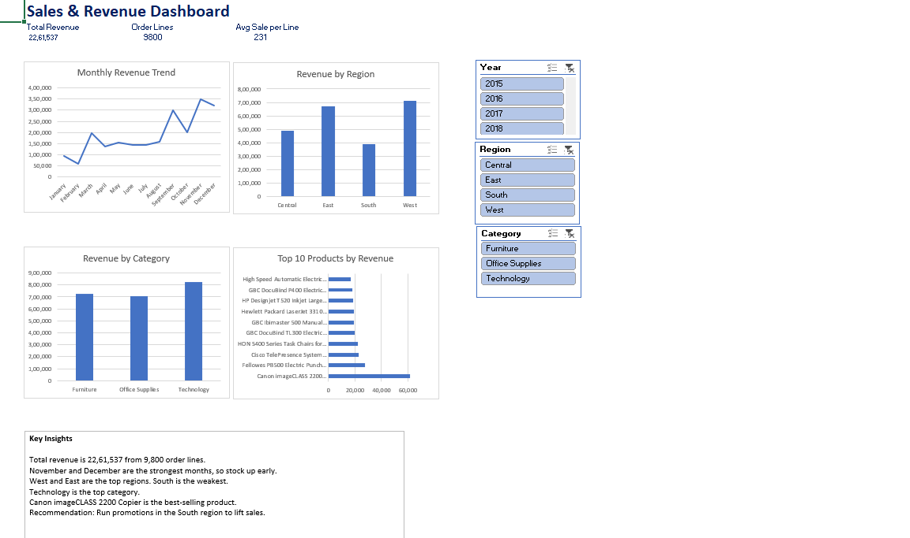

# Sales & Revenue Analysis Dashboard (Excel)

## Objective
Analyze sales data to track KPIs, revenue trends, and top products.

## Dataset
Superstore Sales dataset (9,800 rows) from Kaggle.

## Tools
Excel, Power Query, PivotTables, PivotCharts, Slicers

## Process
1. Imported the CSV with Power Query
2. Cleaned the data (date types, trimmed text, added Year and Month columns)
3. Built 5 PivotTables and 4 charts
4. Added slicers for Region, Category and Year
5. Wrote business insights

## Key Insights
- Total revenue: 22,61,537 from 9,800 order lines
- November and December are the strongest months
- West and East lead on revenue; South is weakest
- Technology is the top category
- Canon imageCLASS 2200 Copier is the best-selling product

## Recommendation
Run promotions in the South region to lift sales.

## Files
- Sales_Dashboard.xlsx: interactive dashboard
- Sales_Dashboard.pdf: static export
- sales_working.csv: dataset
